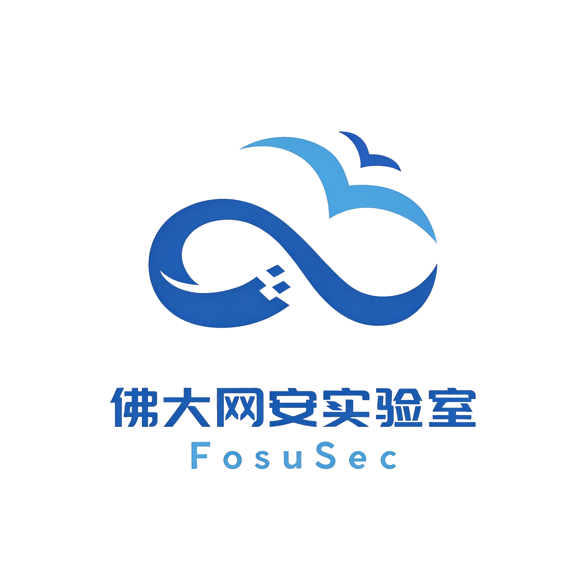

# FosuSec · 佛大网络安全实验室

  

### 📝 简介 | About

🏫 佛大网络安全实验室（FosuSec）致力于网络安全技术研究、CTF 竞赛与安全人才培养。

   FosuSec (Foshan University Cybersecurity Lab) focuses on cybersecurity research, CTF competitions, and talent development.

### 🎯 目标 | Goals

🌱 深耕攻防实战，以赛促学，培养兼具安全研究能力与工程素养的网络安全人才。

   Advance offensive and defensive security skills through hands-on practice and competitions, and cultivate security talents with both research ability and engineering discipline.

### ✨ 座右铭 | Motto

> 守护数字世界的每一道防线。
> *“Guard every line of defense in the digital world.”*
